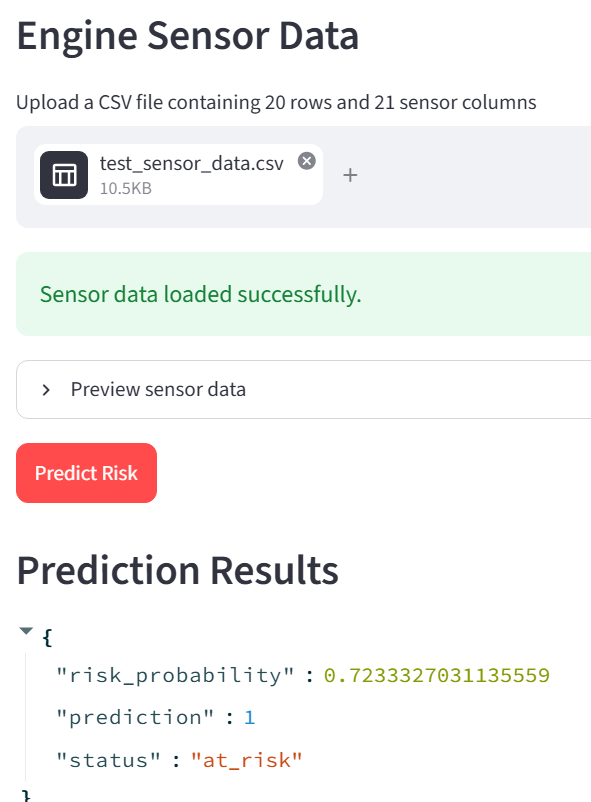

# Predictive Maintenance Using LSTM

An end-to-end machine learning project that classifies machine operating conditions as **at risk** or **healthy** using multivariate time-series sensor data from the NASA C-MAPSS FD001 dataset.

## Project Overview

Unexpected equipment failures can cause costly downtime. This project explores how historical sensor measurements can be used to identify potentially risky operating conditions before failure.

A sequence-based Long Short-Term Memory (LSTM) neural network is trained to classify machine states using a sliding window of sensor measurements.


## Architecture

- **Data processing:** Pandas, NumPy
- **Machine learning:** Scikit-learn, PyTorch
- **Backend API:** FastAPI, Pydantic
- **Frontend:** Streamlit
- **Deployment:** Docker, Docker Compose

### Pipeline

1. Load and explore the NASA C-MAPSS FD001 dataset.
2. Generate binary labels based on a remaining useful life threshold of 20 cycles.
3. Create sliding windows of 20 consecutive cycles using 21 sensor features.
4. Split the training data by engine to reduce data leakage between training and validation.
5. Fit feature scaling on training data and apply it to validation data.
6. Train and evaluate a Logistic Regression baseline and an LSTM classifier.
7. Save the trained model and preprocessing scaler.
8. Serve predictions through FastAPI and a Streamlit interface.

## Model Performance

The following results were obtained on the validation set.

| Metric | Logistic Regression | LSTM |
|---|---:|---:|
| Accuracy | 94.82% | 98.05% |
| Precision | 69.12% | 89.01% |
| Recall | 98.57% | 94.52% |
| F1-score | 81.26% | 91.69% |
| ROC-AUC | 99.33% | 99.68% |

The LSTM achieved a higher F1-score and precision than the baseline while maintaining strong recall. In predictive maintenance, recall is particularly relevant because missed at-risk cases may be costly.

These are validation results; they should not be interpreted as final performance on an independent test set.


## Application Preview




## Running the Application

### Prerequisites

- Docker Desktop with Docker Compose
- Git

### Start the application

Clone the repository and navigate to the directory containing `docker-compose.yml`.

```bash
git clone <YOUR_GITHUB_REPOSITORY_URL>
cd <YOUR_PROJECT_DIRECTORY>
docker compose up --build
```

Open the Streamlit interface at:

http://localhost:8501

The FastAPI interactive documentation is available at:

http://localhost:8000/docs

To stop the containers:

```bash
docker compose down
```

## API

The FastAPI backend exposes a prediction endpoint:

`POST /predict`

The request contains a window of 20 time steps, each with 21 sensor values.

Example request structure:

```json
{
  "window": [
    [0.1, 0.2, 0.3]
  ]
}
```

This abbreviated example illustrates the JSON structure only. A valid request must contain exactly 20 rows and 21 values per row.

The API returns a risk probability, a binary prediction, and a human-readable status.

## Repository Structure

```text
predictive-maintenance/
├── Dockerfile
├── Dockerfile.streamlit
├── docker-compose.yml
├── requirements.txt
├── main.py
├── streamlit_app.py
├── model.pt
├── scaler.pkl
└── README.md
```

Adjust this structure if your actual repository differs.

## Limitations

- The model uses a binary risk label derived from an RUL threshold; it does not directly predict the number of cycles remaining.
- Validation metrics do not guarantee performance on real industrial equipment.
- Predictions depend on the input having the expected feature order, shape, and preprocessing.
- The Streamlit interface demonstrates the inference workflow; operational deployment would require further monitoring and validation.

## Future Improvements

- Evaluate the model on the official held-out test engines.
- Add automated tests for preprocessing and API input validation.
- Improve the interface with clearer input validation and prediction explanations.
- Investigate performance across different operating conditions.

## Dataset

NASA C-MAPSS turbofan engine degradation simulation dataset, using the FD001 subset.

